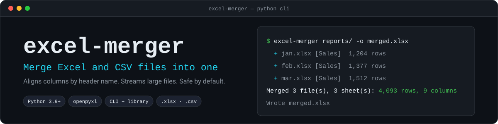

<div align="center">



<br>


</div>

Combine a folder of monthly reports, exports from several systems, or a pile of CSVs into a single workbook. Columns are matched **by header name**, so files whose columns are in a different order, or that have extra columns, still line up.

```console
$ excel-merger reports/ -o merged.xlsx
  + jan.xlsx [Sales]  1,204 rows
  + feb.xlsx [Sales]  1,377 rows
  + mar.xlsx [Sales]  1,512 rows
Merged 3 file(s), 3 sheet(s): 4,093 rows, 9 columns
Wrote merged.xlsx
```

## Install

Requires Python 3.9 or newer. The only dependency, [openpyxl](https://openpyxl.readthedocs.io/), is installed for you.

```bash
pip install git+https://github.com/nyxashu25/excel-merger.git
```

Or from a clone:

```bash
git clone https://github.com/nyxashu25/excel-merger.git
cd excel-merger
pip install .
```

## Usage

```bash
# Stack every .xlsx, .xlsm and .csv in a folder into one sheet
excel-merger reports/ -o merged.xlsx

# Mix files, folders and patterns (quote patterns so your shell does not expand them)
excel-merger january.xlsx exports/ "archive/2024-*.csv" -o merged.xlsx

# Drop rows that are exact duplicates of an earlier row
excel-merger reports/ -o merged.xlsx --dedupe

# Keep each source sheet as its own sheet instead of stacking rows
excel-merger reports/ -o book.xlsx --mode sheets

# Headers are on row 3 (rows 1-2 hold a title), and only the "Sales" sheets are wanted
excel-merger reports/ -o merged.xlsx --header-row 3 --sheet Sales

# CSV out (fastest, and not limited by Excel's row limit)
excel-merger reports/ -o merged.csv
```

`python -m excel_merger ...` works too.

### Options

| Option | Meaning |
|---|---|
| `INPUT...` | Files, folders or glob patterns. Folders are scanned for `.xlsx`, `.xlsm` and `.csv`, in natural order (`report2` before `report10`) |
| `-o, --output` | Output file, `.xlsx` or `.csv` (required) |
| `--mode stack` | Default. Combine all rows into one sheet named `Merged`, aligned by column name |
| `--mode sheets` | Copy every source sheet into its own sheet. Output must be `.xlsx` |
| `--sheet NAME` | Only merge sheets with this name. Repeatable, case-insensitive. Applies to Excel files; CSV files are always included |
| `--header-row N` | Row holding the column names, default `1`. Rows above it are ignored |
| `-r, --recursive` | Also search sub-folders of folder inputs |
| `--no-source` | Do not add the `Source file` and `Source sheet` columns |
| `--dedupe` | Remove rows identical to an earlier row (stack mode) |
| `--match-case` | Treat `Email` and `email` as different columns |
| `--include-hidden` | Also merge hidden sheets |
| `--delimiter CHAR` | CSV delimiter. Detected automatically when omitted |
| `--overwrite` | Replace the output file if it already exists |
| `-q, --quiet` | Print only errors |

Exit codes: `0` success, `1` a problem with the inputs or output (message on stderr), `2` invalid command-line usage.

## How it behaves

**Column matching.** Headers are compared after trimming whitespace and ignoring case, so `Email`, `email` and ` EMAIL ` are one column. The first spelling seen is used in the output. Output columns appear in the order they are first met. A file that lacks a column gets empty cells there.

**Odd headers.** A blank header becomes `Column N`. A repeated header within one sheet becomes `name (2)`. Data that extends past the last header is kept under a `Column N` name instead of being dropped.

**Source columns.** Unless you pass `--no-source`, two columns at the end record where each row came from: the file name (not its full path) and the sheet name. If your data already has a column with one of those names, the new one becomes `Source file (2)` rather than overwriting it.

**What is skipped.** Empty rows, hidden sheets (unless `--include-hidden`), Excel lock files (`~$name.xlsx`) and dotfiles.

**Values.**
- Numbers, dates and booleans keep their types.
- Formulas are read as the **values Excel last calculated**. A file that was never opened and saved in Excel or LibreOffice has no calculated values, and those cells come through empty.
- CSV values stay as text, with no guessing that `007` is a number.
- In `.xlsx` output, text that starts with `=` is stored as text, never as a formula, so a hostile CSV cannot plant a live formula in your merged workbook. A `.csv` output is plain text, so Excel will treat a leading `=` as a formula when it opens the file, exactly as it would for any CSV.
- In `.xlsx` output, control characters that Excel cannot store are removed.

**CSV files.** UTF-8 (with or without a byte-order mark) is tried first, then Windows-1252. The delimiter is detected among `,` `;` tab and `|`. CSV output is written as UTF-8 with a BOM so Excel opens accents correctly.

**Safe by default.**
- Input files are opened read-only and never modified.
- The output is built in a temporary file and moved into place only when it is complete, so a failure never leaves a half-written result.
- It refuses to overwrite an existing file without `--overwrite`, and refuses to use one of its inputs as the output.
- If the output sits inside an input folder, it is excluded from the inputs so re-running does not merge the previous result into itself.

## Limits

- **Excel's row limit.** One sheet holds at most 1,048,576 rows. If the merged result is larger you get a clear error before the work starts (or, with `--dedupe`, as soon as the limit is hit). Write a `.csv` instead.
- **No legacy `.xls`.** Open the file in Excel and save it as `.xlsx` first. The error message says so.
- **Speed.** Files are streamed in two passes (the first learns the headers so columns can be aligned), which keeps memory flat for large inputs. Throughput is bounded by openpyxl: roughly 3,000 rows per second to `.xlsx` and 6,000 to `.csv` for a 14-column file on an ordinary laptop, so 100,000 rows takes around half a minute. Files produced by Excel open faster than files written by streaming libraries, which omit the size hint openpyxl looks for.
- **`--dedupe` uses memory** proportional to the number of distinct rows.

## Use it from Python

```python
from excel_merger import merge_files, MergeError

try:
    result = merge_files(
        ["reports/", "extra.csv"],
        "merged.xlsx",
        dedupe=True,
        header_row=2,
    )
except MergeError as exc:
    print(f"Could not merge: {exc}")
else:
    print(result.rows, "rows from", result.files, "files")
    for warning in result.warnings:
        print("warning:", warning)
```

`merge_files` accepts the same options as the command line (`mode`, `sheets`, `header_row`, `recursive`, `source_columns`, `dedupe`, `match_case`, `include_hidden`, `delimiter`, `overwrite`) and returns a `MergeResult` with `rows`, `columns`, `files`, `sheets`, `duplicates_removed` and `warnings`.

## Development

```bash
pip install -e .
python -m unittest discover -s tests -v
```

The tests build small workbooks on the fly and cover column alignment, header matching, de-duplication, header rows, hidden and filtered sheets, CSV encodings and delimiters, formula safety, sheet-name sanitizing, output safety (no overwrite, no temp files left behind, clean failure at Excel's row limit) and the command-line interface.

```
src/excel_merger/
├── core.py       # reading, aligning and writing
├── cli.py        # argument parsing and output
└── __main__.py   # python -m excel_merger
tests/
```
